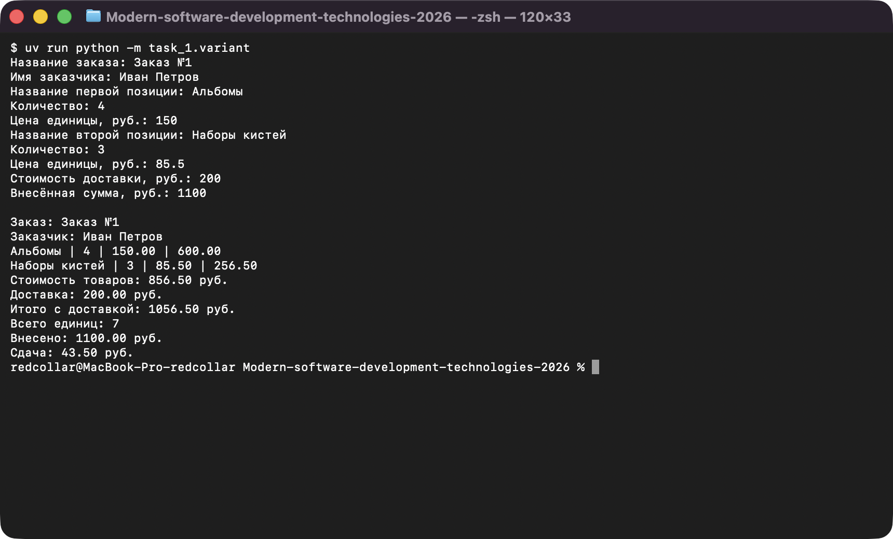
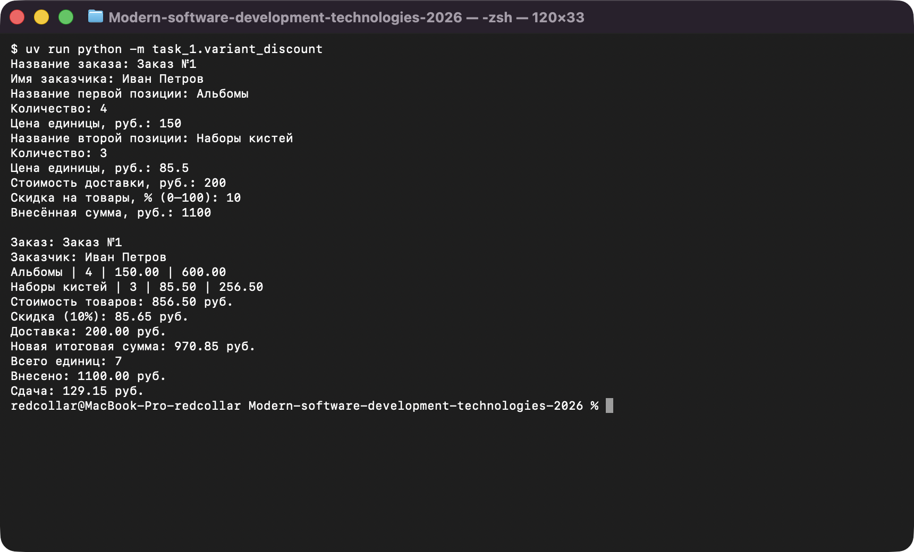
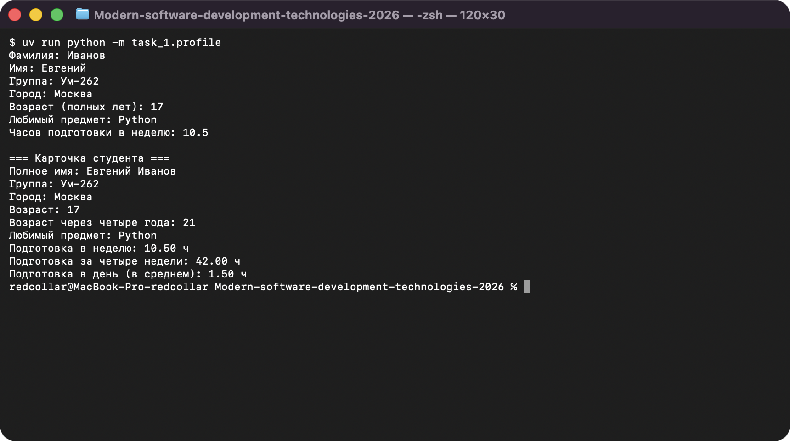
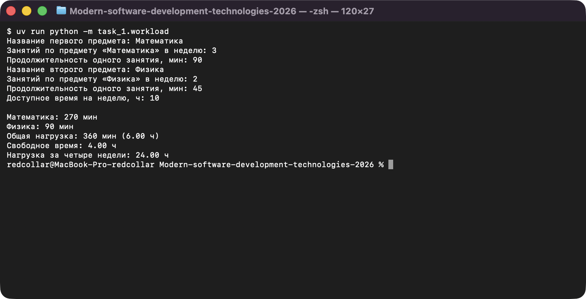
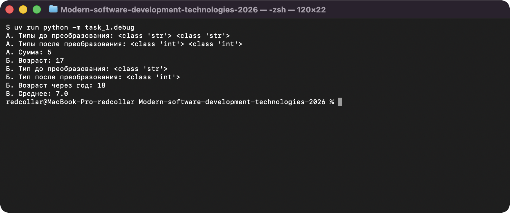
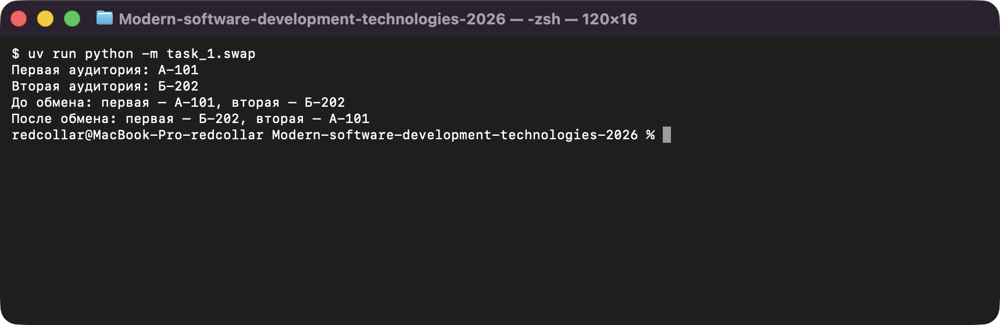

# Задание 1. Первые программы на Python

Исполнитель: Извеков Евгений Александрович, группа Ум-262, **вариант 4**.
Источник условия: [01_Введение.md](https://github.com/vvdRTM/Python2026/blob/main/01_Введение.md).

## Условие

Научиться запускать Python-файл, отличать строку от числа, получать данные от пользователя, выполнять простые расчёты и оформлять результат. До работы №10 считается, что пользователь вводит данные нужного типа.

| Файл | Что сделать |
|---|---|
| `hello.py` | Вывести две строки: `Изучаю Python` и `Лабораторная работа 1`. |
| `profile.py` | Запросить фамилию, имя, группу, город, возраст (1–120), любимый предмет, часы подготовки в неделю. После всего ввода вывести карточку: имя в порядке «имя фамилия», возраст через 4 года, часы за 4 недели и среднее в день (неделя = 7 дней), часы с двумя знаками. |
| `workload.py` | Запросить два предмета, для каждого число занятий в неделю и длительность занятия (мин), затем доступное время в часах. Вывести минуты по предметам, общую нагрузку в минутах и часах, остаток времени, нагрузку за 4 недели. |
| `debug.py` | Исправить три ошибочных фрагмента (А: сумма `"2"+"3"` должна быть 5; Б: `input() + 1`; В: среднее `4, 7, 10` должно быть `7.0`), объяснить исправления, для А и Б вывести типы до и после преобразования. |
| `swap.py` | Ввести две аудитории, вывести их, поменять местами через третью переменную, вывести снова. |
| `variant.py` | **Вариант 4.** Заказ «Художественная мастерская», позиции «Альбомы» и «Наборы кистей». Ввод: название заказа, заказчик, по каждой позиции название, количество, цена; доставка и внесённая сумма. Вывод: заголовок, заказчик, строки `название \| количество \| цена \| стоимость`, стоимость товаров, итог с доставкой, число единиц, сдача (деньги с двумя знаками). Только последовательные команды. |
| `variant_discount.py` | **Дополнительно.** То же с процентной скидкой (0–100) на товары, без скидки на доставку; вывести размер скидки в рублях и новую итоговую сумму. |

## Запуск

Из корня репозитория (см. [главный README](../README.md)):

```bash
uv run python -m task_1.hello
uv run python -m task_1.profile
uv run python -m task_1.workload
uv run python -m task_1.debug
uv run python -m task_1.swap
uv run python -m task_1.variant
uv run python -m task_1.variant_discount
```

## Собственный пример для варианта (расчёт вручную до запуска)

Заказ «Заказ №1», заказчик «Иван Петров». Альбомы: 4 шт. × 150.00 руб.; Наборы кистей: 3 шт. × 85.50 руб.; доставка 200.00; внесено 1100.00.

- Альбомы: 4 · 150 = 600.00
- Наборы кистей: 3 · 85.5 = 256.50
- Товары: 600 + 256.5 = 856.50
- Итого с доставкой: 856.5 + 200 = 1056.50
- Единиц: 4 + 3 = 7
- Сдача: 1100 − 1056.5 = 43.50

Для расширенной версии со скидкой 10 %: скидка 856.5 · 0.1 = 85.65; новый итог 856.5 − 85.65 + 200 = 970.85; сдача 1100 − 970.85 = 129.15.

## Проверки

Ожидаемое — по условию (либо рассчитано вручную), фактическое — вывод программы при запуске.

| Программа | Вход | Ожидаемый результат | Фактический результат |
|---|---|---|---|
| `hello.py` | — | две строки | `Изучаю Python` / `Лабораторная работа 1` — совпало |
| `profile.py` | возраст `17`, `10.5` ч | возраст через 4 года `21`, `42.00` ч, `1.50` ч/день | `21`, `42.00 ч`, `1.50 ч` — совпало |
| `profile.py` | возраст `17`, `0` ч | `0.00` во всех часовых полях | `0.00 ч`, `0.00 ч`, `0.00 ч` — совпало |
| `workload.py` | Математика 3×90, Физика 2×45, доступно `10` | `270`, `90`, `360` мин (`6.00` ч), остаток `4.00`, за 4 недели `24.00` | `270 мин`, `90 мин`, `360 мин (6.00 ч)`, `4.00 ч`, `24.00 ч` — совпало |
| `workload.py` | занятий нет (0 и 0), доступно `10` | нагрузка `0`, остаток `10.00` | `0 мин`, `0.00 ч`, остаток `10.00 ч` — совпало |
| `debug.py` | Б: `17` | `5`, `18`, `7.0` | `А. Сумма: 5`, `Б. Возраст через год: 18`, `В. Среднее: 7.0` — совпало |
| `swap.py` | `А-101`, `Б-202` | поменялись местами | первая — `Б-202`, вторая — `А-101` — совпало |
| `swap.py` | `А-101`, `А-101` | остались одинаковыми | обе `А-101` — совпало |
| `variant.py` | 3×12.50, 2×20.00, доставка `10`, внесено `100` | `37.50`, `40.00`, товары `77.50`, всего `87.50`, единиц `5`, сдача `12.50` | те же значения — совпало |
| `variant.py` | моя проверка: 4×150, 3×85.5, доставка `200`, внесено `1100` | `600.00`, `256.50`, `856.50`, `1056.50`, `7`, `43.50` | те же значения — совпало |
| `variant.py` | нулевое количество, нулевая доставка, точная оплата (0×12.5, 2×20, `0`, `40`) | `0.00`, `40.00`, итого `40.00`, сдача `0.00` | те же значения — совпало |
| `variant.py` | названия из нескольких слов (`Наборы кистей`, `Заказ №1`) | выводятся целиком | выводятся целиком — совпало |
| `variant_discount.py` | скидка `10` % к моему примеру | скидка `85.65`, итог `970.85`, сдача `129.15` | те же значения — совпало |

## Пояснения исправлений в `debug.py`

- **А.** `input`/литералы типа `str`: `+` соединяет строки. Нужно привести к `int` до сложения.
- **Б.** `input()` всегда возвращает `str`; `str + int` вызывает `TypeError`. Преобразуем в `int`.
- **В.** Деление выполняется раньше сложения: `4 + 7 + 10 / 3`. Сумму нужно взять в скобки.

## Вопросы для защиты (кратко)

- **Строка и число.** `"2" + "3" == "23"`, а `2 + 3 == 5`: тип определяет смысл операции.
- **Порядок вычислений.** Сначала `*` и `/`, затем `+` и `-`; скобки меняют порядок.
- **Временная переменная при обмене.** Без неё первое присваивание затёрло бы исходное значение.
- **Деньги.** `:.2f` задаёт два знака после точки при выводе.

## Скриншоты

Запуск программ (ввод подставлен автоматически, вывод — реальный):

**variant.py — расчёт заказа (вариант 4)**



**variant_discount.py — заказ со скидкой (дополнительно)**



**profile.py — карточка студента**



**workload.py — учебная нагрузка**



**debug.py — исправленные фрагменты**



**swap.py — обмен значениями**


