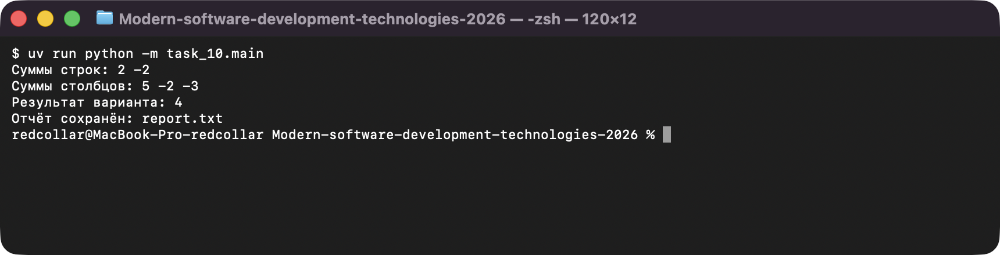
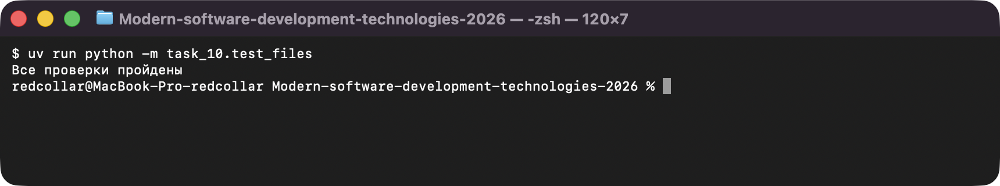

# Задание 10. Текстовые файлы и обработка ошибок

Исполнитель: Извеков Евгений Александрович, группа Ум-262, **вариант 4**.
Источник условия: [10_Файлы.md](https://github.com/vvdRTM/Python2026/blob/main/10_Файлы.md).

## Условие

Читать и сохранять текст в UTF-8, проверять формат данных, обрабатывать ожидаемые ошибки без потери исходного файла.

| Файл | Что сделать |
|---|---|
| `main.py` | `read_positive_integer()` — повторять ввод, пока не получено целое > 0; разные сообщения для «не целое» и «должно быть больше нуля». Основная программа: прочитать `matrix.txt`, найти суммы строк и столбцов и **только после успешной проверки** записать `report.txt`; обработать отсутствие файла, неверный формат, кодировку, ошибки доступа. При ошибке существующий `report.txt` не меняется; входной файл не открывается на запись. |
| `files_lab.py` | `read_matrix(path)`: первая строка — два положительных целых (строки, столбцы), далее ровно столько строк по столько целых; лишние и пустые строки — ошибка, один перевод строки в конце допустим; `ValueError` с пояснением и номером строки. |
| `files_lab.py` (вариант) | **Вариант 4:** `selected_sum(matrix)` — сумма **нечётных** элементов (для `matrix.txt` ответ `4`); строка `Результат варианта: ...` в отчёте. |
| `files_lab.py` (доп.) | **Дополнительно:** `export_csv(matrix, path)` через модуль `csv`; запуск — `csv_export.py`. |
| `table.py` (из задания 9) | Условие предлагает скопировать модуль. Вместо копии он импортируется: `from task_9.table import column_sums, row_sums` — дубль кода не нужен. Чтение целых и проверка нечётности тоже взяты из `common/`. |
| `positive_demo.py` | Демонстрация `read_positive_integer()`. |
| `matrix.txt`, `report.txt` | Входной файл (UTF-8) и пример отчёта. |
| `test_files.py` | Проверки на `assert` во временной папке (`TemporaryDirectory`). |

Формат `matrix.txt`:

```text
2 3
1 -2 3
4 0 -6
```

Пример `report.txt`:

```text
Суммы строк: 2 -2
Суммы столбцов: 5 -2 -3
Результат варианта: 4
```

## Запуск

Из корня репозитория:

```bash
uv run python -m task_10.main                      # matrix.txt -> report.txt
uv run python -m task_10.main путь/matrix.txt путь/report.txt   # свои пути
uv run python -m task_10.positive_demo
uv run python -m task_10.csv_export
uv run python -m task_10.test_files
```

## Проверки

Автоматические (`test_files.py`, выводит `Все проверки пройдены`):

| Содержимое или ситуация | Ожидаемое поведение | Фактическое |
|---|---|---|
| `1 2` / `7 -1` | `[[7, -1]]` | совпало |
| `matrix.txt` из задания (в т. ч. без конечного перевода строки) | `[[1, -2, 3], [4, 0, -6]]` | совпало |
| `1 1` и строка `0` | `[[0]]` | совпало |
| пустой файл | `ValueError` | совпало |
| заголовок `0 3` | `ValueError` | совпало |
| заголовок `1 2`, строка `1` | `ValueError`, «Строка 2» | совпало |
| заголовок `1 2`, строка `1 x` | `ValueError`, «Строка 2» | совпало |
| заголовок `1 1`, две строки данных | `ValueError` | совпало |
| заголовок `2 1`, одна строка данных | `ValueError` | совпало |
| лишняя пустая строка в конце | `ValueError` | совпало |
| заголовок `a b` | `ValueError`, «Строка 1» | совпало |
| отсутствующий путь | `FileNotFoundError` | совпало |
| `selected_sum`: матрица из задания; без нечётных; `[[7]]`; `[[-3, -5]]` | `4`; `0`; `7`; `-8` | совпало |
| отчёт по `matrix.txt` | три строки как в примере выше | совпало |
| неверный формат / нет файла / не UTF-8 | код `1`, сообщение; `report.txt` и входной файл без изменений | совпало |
| экспорт CSV, чтение через `csv.reader` | `[["1","-2","3"],["4","0","-6"]]` | совпало |

Ручные проверки:

| Программа | Ввод | Ожидаемый результат | Фактический результат |
|---|---|---|---|
| `positive_demo.py` | `abc`, `0`, `-2`, `3` | «не целое число», дважды «должно быть больше нуля», принято `3` | то же — совпало |
| `main.py` | `matrix.txt` | отчёт: строки `2 -2`, столбцы `5 -2 -3`, вариант `4` | то же, `report.txt` записан — совпало |
| `main.py` | `bad.txt` с содержимым `2 2` / `1 2` (мало строк) | `Ошибка формата: Ожидалось строк данных: 2, найдено: 1`, код `1`; старый `report.txt` без изменений | то же, отчёт прежний — совпало |
| `main.py` | несуществующий путь | `Ошибка: файл не найден`, код `1` | то же — совпало |
| `csv_export.py` | `matrix.txt` | `matrix.csv`: `1,-2,3` / `4,0,-6` | то же — совпало |

## Вопросы для защиты (кратко)

- **Формат и доступ.** Ошибки формата (`ValueError`) — проблема содержимого, которую можно исправить правкой файла; ошибки доступа (`OSError`, `FileNotFoundError`) — проблема среды (нет файла, нет прав).
- **Порядок `except`.** `FileNotFoundError` — подкласс `OSError`, а `UnicodeDecodeError` — подкласс `ValueError`; частные обработчики ставятся раньше общих.
- **Когда открывать отчёт на запись.** Режим `w` стирает содержимое, поэтому отчёт открывается только после чтения, проверки и вычисления всего текста — иначе при ошибке потеряется прежний отчёт.
- **CSV.** Используется модуль `csv`, а не `split(",")`: значения могут содержать разделители и кавычки.

## Скриншоты

Запуск программ (ввод подставлен автоматически, вывод — реальный):

**main.py — отчёт, включая результат варианта 4**



**test_files.py — проверки**


