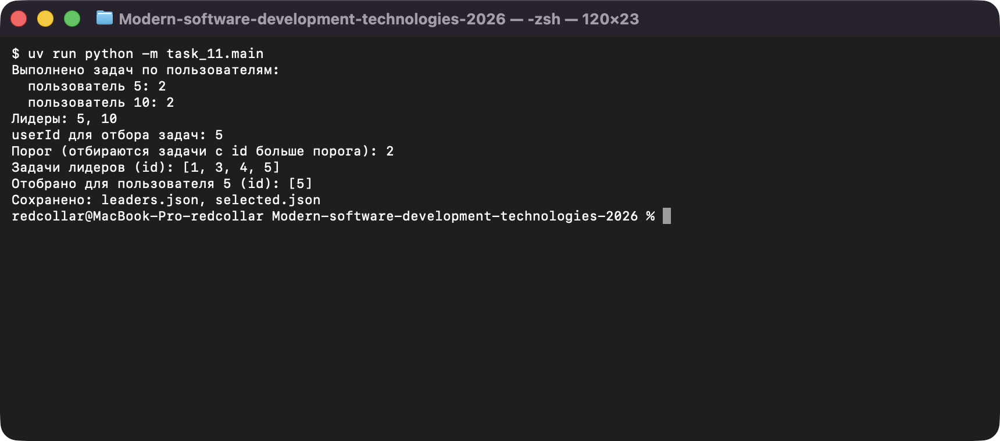
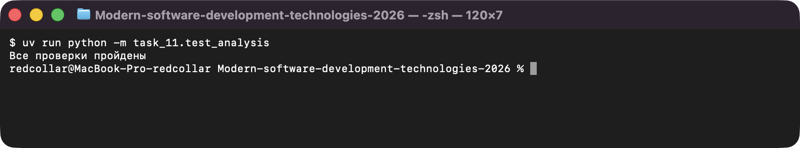

# Задание 11. JSON и получение данных по HTTP

Исполнитель: Извеков Евгений Александрович, группа Ум-262, **вариант 4**.
Источник условия: [11_JSON_HTTP.md](https://github.com/vvdRTM/Python2026/blob/main/11_JSON_HTTP.md).

## Условие

Читать и записывать JSON, проверять структуру полученных данных, отделять сетевой запрос от обработки и тестировать программу без интернета.

| Файл | Что сделать |
|---|---|
| `todos.json` | Учебный набор из 5 задач (точное содержимое из условия). |
| `analysis.py` | `validate_todos(data)` — корень список; записи — словари с положительными целыми `id`, `userId` (строго `type(...) is int`), непустой строкой `title`, `completed` строго `bool`; `id` уникален; доп. ключи допустимы; иначе `ValueError`. `completion_counts(todos)` — выполненные задачи для **всех** пользователей (включая 0). `top_users(counts)` — отсортированный список лидеров; для `{}` и максимума `0` — `[]`. |
| `analysis.py` (вариант) | **Вариант 4:** `select_tasks(todos, user_id, parameter)` — задачи пользователя, у которых **`id` больше порога**. Пример: `user_id=5`, порог `2` → задачи с `id` `[5]`. |
| `main.py` | Прочитать и проверить `todos.json`, вывести сводку, сохранить `leaders.json` (завершённые задачи лидеров, `id` `[1, 3, 4, 5]`) и `selected.json` (результат варианта). Ввод `userId` — положительное целое, порог — неотрицательное целое, с повторным вводом. Обработка: нет файла, не UTF-8, `JSONDecodeError`, ошибка структуры, ошибки доступа. При ошибке входа прежние результаты не перезаписываются. |
| `fetch_profile.py` | HTTP-упражнение: GET профиля GitHub по логину (`urllib`), результат в `profile.json`. Сеть не вызывается при импорте. |
| `profile_sample.json`, `read_sample.py` | Режим без сети: учебные данные `{"login": "demo", "id": 1, "name": null}`, вывод логина. |
| `profile_menu.py` | **Дополнительно:** меню выбора источника (сеть / локальный пример) и общая функция вывода профиля. |
| `test_analysis.py` | Проверки на `assert` (без сети, во временной папке). |

> Строгие проверки типов, чтение целых и работа с JSON (UTF-8) вынесены в общий пакет [`common`](../README.md#общий-код): те же функции нужны в заданиях 9 и 10.

## Запуск

Из корня репозитория:

```bash
uv run python -m task_11.main
uv run python -m task_11.fetch_profile   # нужен интернет
uv run python -m task_11.read_sample     # без сети
uv run python -m task_11.profile_menu
uv run python -m task_11.test_analysis
```

## Проверки

Автоматические (`test_analysis.py`, выводит `Все проверки пройдены`):

| Что проверяется | Ожидаемое | Фактическое |
|---|---|---|
| учебный набор | количества `{5: 2, 10: 2}`, лидеры `[5, 10]`, задачи лидеров `[1, 3, 4, 5]` | совпало |
| пустой список; набор только с `completed=false` | лидеров нет, выборка пуста; пользователь с нулём присутствует в счётчиках | совпало |
| единственный лидер / несколько с равным результатом | `[5]` / `[5, 10]` | совпало |
| вариант: `user_id=5`, порог `2` | `id` `[5]` | совпало |
| вариант: неизвестный пользователь; непустой набор без совпадений (порог `5`) | `[]` | совпало |
| вариант: граница — порог `1` и `0` | `[2, 5]` и `[1, 2, 5]` (`id == порогу` не входит) | совпало |
| вариант: исходные записи после вызова | не изменены | совпало |
| вместо списка объект; повторный `id`; нет `userId`; `completed="false"`; `id=true`; пустой `title`; `id=0`; элемент не словарь | `ValueError` | совпало |
| дополнительный ключ в записи | допустим | совпало |
| запись и повторное чтение `selected.json` и `leaders.json` | структура равна исходной выборке | совпало |
| битый JSON / не UTF-8 / неверная структура / нет файла | сообщение об ошибке; `leaders.json` и `selected.json` не изменены | совпало |

Ручные запуски:

| Программа | Ввод | Ожидаемый результат | Фактический результат |
|---|---|---|---|
| `main.py` | `abc`, `0`, `-5`, `5` (userId); `x`, `-1`, `2` (порог) | сообщения об ошибках ввода, затем лидеры `[1, 3, 4, 5]`, выборка `[5]`, файлы сохранены | то же — совпало |
| `main.py` | userId `99`, порог `0` | выборка `[]` | то же — совпало |
| `fetch_profile.py` | `octocat` (интернет доступен) | `Профиль сохранён: octocat`, файл `profile.json` | то же — совпало |
| `fetch_profile.py` | пробелы | `Ошибка данных: Логин не должен быть пустым` | то же — совпало |
| `read_sample.py` | — | `Логин: demo` | то же — совпало |
| `profile_menu.py` | `2` / `3` | профиль `demo`, имя `не указано` / `Неизвестный пункт меню` | то же — совпало |

## HTTP-упражнение: пояснения

- **Адрес.** `https://api.github.com/users/<логин>` — профиль **пользователя** по логину (не репозиторий); логин экранируется через `quote`.
- **GET.** Метод чтения ресурса без изменения данных на сервере. Статус `200` — успех, `404` — пользователь не найден, `403`/`429` — ограничения доступа или частоты запросов.
- **Таймаут.** `timeout=10` не даёт программе зависнуть, если сервер не отвечает.
- **Обработчики.** `HTTPError` — сервер ответил статусом ошибки; `URLError`/`TimeoutError` — нет связи; `ValueError`/`UnicodeError` — неверные данные ответа (его подкласс `JSONDecodeError` тоже сюда); `OSError` — ошибки записи файла. Частные обработчики стоят раньше общих (`HTTPError` — подкласс `URLError`, который подкласс `OSError`).
- Поле `name` в `profile_sample.json` равно `null`; пропущенные значения не заменяются выдуманными.

## Вопросы для защиты (кратко)

- **Почему `type(value) is int`.** `True` тоже проходит `isinstance(True, int)`, но идентификатором быть не может.
- **Почему `JSONDecodeError` раньше `ValueError`.** Это подкласс `ValueError`: иначе общий обработчик перехватил бы его и сообщение о разборе JSON потерялось.
- **Тесты без сети.** Сетевой вызов находится в `fetch_profile`/`main()` и не выполняется при импорте; логика анализа тестируется на локальных данных.

## Скриншоты

Запуск программ (ввод подставлен автоматически, вывод — реальный):

**main.py — анализ и выборка задач (вариант 4)**



**test_analysis.py — проверки**


