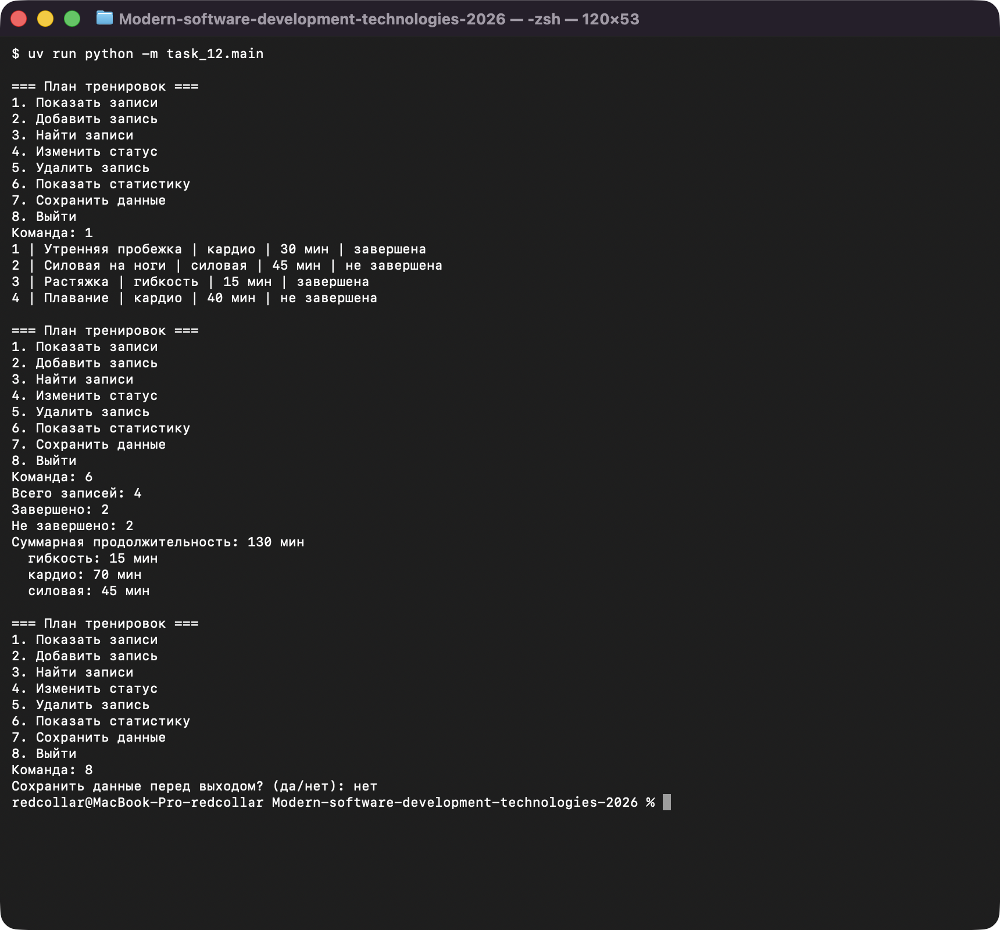
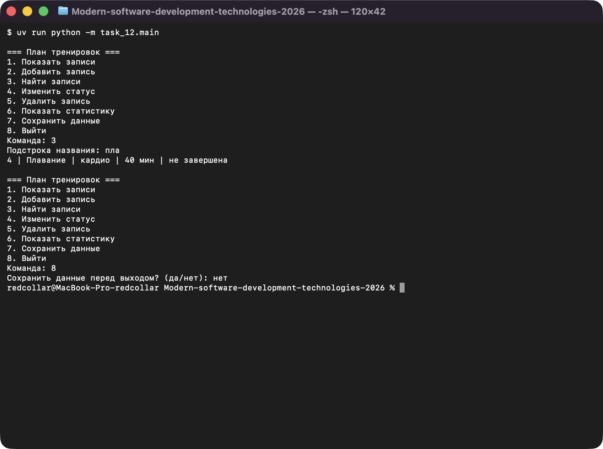
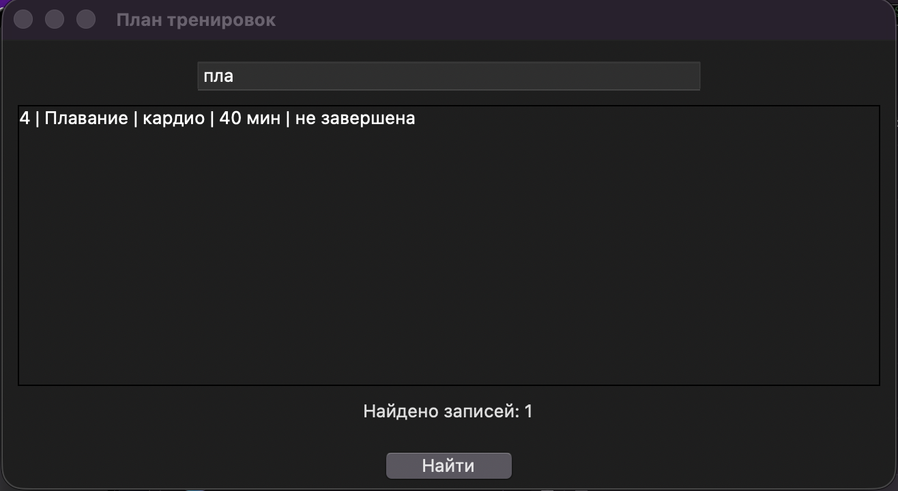
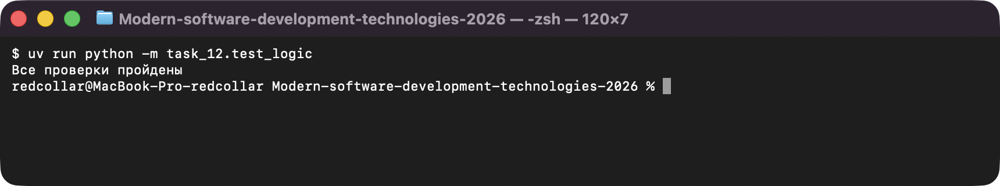
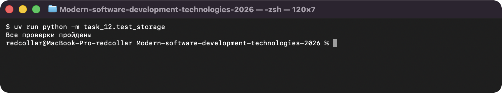

# Задание 12. Итоговый проект «План тренировок»

Автор: Извеков Евгений Александрович, группа Ум-262, **вариант 4**.
Источник условия: [12_Проект.md](https://github.com/vvdRTM/Python2026/blob/main/12_Проект.md).
Версия Python: 3.13+ (проверено на 3.14). Внешние библиотеки не нужны (стандартная библиотека, для GUI — `tkinter`).

## Условие

Создать законченную консольную программу: условия, циклы, коллекции, функции, проверка данных и JSON.

**Вариант 4 — «План тренировок»:** `amount` — продолжительность в минутах, `completed` — «тренировка завершена».

Консольное меню работает в цикле до выхода, неверная команда — сообщение и повторный показ меню:

1. **Показать записи** — ID, название, категория, минуты, статус, по возрастанию ID; пусто → `Нет записей`.
2. **Добавить запись** — название, категория, минуты; некорректный ввод повторяется; статус `False`; одинаковые названия разрешены.
3. **Найти записи** — по подстроке названия без учёта регистра; пустой запрос отклоняется; ничего нет → сообщение.
4. **Изменить статус** — по ID, явно «завершена» / «не завершена»; неизвестный ID данные не меняет.
5. **Удалить запись** — по ID после подтверждения `да`; иначе отмена; неизвестный ID — сообщение.
6. **Показать статистику** — всего, завершено, не завершено, сумма минут, суммы по категориям (по алфавиту).
7. **Сохранить данные** — запись в JSON UTF-8; об успехе сообщается только после успешной записи.
8. **Выйти** — предложение сохранить: `да` → сохранение (при ошибке остаёмся в меню), `нет` → выход без записи, иное → повтор вопроса.

При запуске загружается `data.json`; файла нет → пустой список и сообщение; повреждённый JSON, неверная кодировка или структура → причина и завершение запуска **без перезаписи файла**.

## Структура

```text
task_12/
    main.py          меню, ввод, сообщения
    logic.py         проверка записей, добавление, поиск, статус, удаление, статистика
    storage.py       чтение и запись JSON (без диалогов)
    gui.py           дополнительно: окно поиска (tkinter)
    test_logic.py    автоматические проверки логики
    test_storage.py  автоматические проверки хранения (во временной папке)
    data.json        вымышленный набор данных
    README.md
```

| Модуль | Контракты |
|---|---|
| `logic.py` | `validate_records` — ничего не меняет, `ValueError` при ошибке. `add_record` — **изменяет** список (добавляет в конец), возвращает новую запись. `set_completed`, `delete_record` — **изменяют** список, возвращают `True` / `False` (неизвестный ID). `find_records`, `find_by_id`, `statistics`, `sorted_by_id` — данные **не меняют**. Состояния в глобальных переменных нет. |
| `storage.py` | `load_records(path)` читает и проверяет, файл не меняет; `save_records(path, records)` проверяет данные, пишет во временный файл и заменяет им целевой — при ошибке прежний файл цел. |

## Формат данных (`data.json`)

Список записей:

```json
[
  {"id": 1, "title": "Утренняя пробежка", "category": "кардио", "amount": 30, "completed": true},
  {"id": 2, "title": "Силовая на ноги", "category": "силовая", "amount": 45, "completed": false}
]
```

- `id` — положительное целое, уникальное; новая запись получает `max + 1` (для пустого списка — `1`); после удаления ID не перенумеровываются.
- `title`, `category` — строки, непустые после `strip()`; при добавлении краевые пробелы убираются.
- `amount` — целое ≥ 0 (логические значения не принимаются); `completed` — строго `bool`.
- Дополнительные ключи допустимы и сохраняются.

Набор в `data.json` (вымышленный): 4 записи — 30 + 45 + 15 + 40 минут; завершены №1 и №3. Ожидаемая статистика (вручную): всего 4, завершено 2, не завершено 2, сумма 130; гибкость 15, кардио 70, силовая 45.

## Запуск

Из корня репозитория:

```bash
uv run python -m task_12.main                  # меню, данные из task_12/data.json
uv run python -m task_12.main путь/data.json   # свой файл данных
uv run python -m task_12.test_logic
uv run python -m task_12.test_storage
uv run python -m task_12.gui                   # дополнительно: окно поиска
```

Программа использует пути относительно своего файла, поэтому работает после распаковки в любую папку.

## Автоматические проверки

`test_logic.py` и `test_storage.py` (каждый выводит `Все проверки пройдены`):

| Что проверяется | Результат |
|---|---|
| пустой список; повторяющиеся названия; id = max + 1 | совпало |
| строгие типы: `id=True`, `amount=True/-1/1.5`, `completed="false"`, пустые строки, нет ключа, повторный id | `ValueError` — совпало |
| неизвестный ID для статуса и удаления | `False`, данные не изменены — совпало |
| поиск `PY` по `Python`; пустой запрос; нет совпадений | найдено / `ValueError` / `[]` — совпало |
| статистика: пустой список; два статуса; две категории (`" кардио "` и `"кардио"` объединяются) | совпало |
| данные после поиска, статистики, сортировки | не изменены — совпало |
| сохранение → загрузка во временной папке | записи равны исходным — совпало |
| повреждённый JSON / не UTF-8 / неверная структура / повторный id | исключение, файл не изменён — совпало |
| ошибка записи (нет каталога) | `OSError`, временного файла нет — совпало |

## Сценарии приёмки (вручную, через меню)

Проверялись на временных файлах; рабочий `data.json` не менялся.

| Сценарий | Ожидаемое поведение | Фактический результат |
|---|---|---|
| Файла нет | Пустой список, меню доступно | `Файл ... не найден: начинаем с пустого списка`, `Нет записей` — совпало |
| JSON содержит `[]` | Список пуст, всё в статистике 0 | `Всего 0`, `Завершено 0`, `Не завершено 0`, `0 мин` — совпало |
| Добавлены записи 4 и 2 мин, вторая завершена | Всего 2, выполнена 1, невыполнена 1, сумма 6 | `2`, `1`, `1`, `6 мин` — совпало |
| Название `  Python  ` | Сохранено `Python` | в меню и в файле `"title": "Python"` — совпало |
| Поиск `PY` при названии `Python` | Запись найдена | `1 \| Python \| ...` — совпало |
| Пустое название, `amount=-1`, `amount=abc` | Повторный ввод, лишней записи нет | три сообщения об ошибке, затем одна запись — совпало |
| Изменение статуса неизвестного ID | Сообщение, данные не изменены | `Запись с таким ID не найдена` — совпало |
| Удаление отменено (`нет`, `может`) | Запись сохранена | `Удаление отменено`, запись на месте — совпало |
| Удалена запись с ID 1 из списка ID 1, 2 | Остаётся ID 2; новая запись получает ID 3 | в файле ID `2`, `3` — совпало |
| Сохранение и перезапуск | Все поля и статусы восстановлены | после перезапуска записи и статусы те же — совпало |
| Повреждённый JSON / повторный ID | Запуск прекращён с сообщением, файл не изменён | `Запуск прекращён: ...`, `cmp` — файл идентичен — совпало |
| Ошибка сохранения (каталога нет) | Нет сообщения об успехе, можно продолжить | `Ошибка сохранения: ...`, меню продолжает работу — совпало |
| Неверная команда; неверный ответ при выходе | Сообщение и повтор | `Неизвестная команда, повторите выбор`; `Ответьте «да» или «нет»` — совпало |

## Путь одной записи (для защиты)

Ввод в `main.add_action` → `logic.add_record` (очистка пробелов, `id = max + 1`, `validate_records`) → список в памяти → `storage.save_records` (проверка, временный файл, замена) → `data.json` (UTF-8, `ensure_ascii=False`) → при следующем запуске `storage.load_records` (чтение и `validate_records`) → снова в списке.

## Дополнительно: графический интерфейс

`gui.py` — окно со строкой поиска, списком и кнопкой «Найти» (также Enter); использует готовую `find_records()`, пустой запрос показывает все записи. Консольная версия остаётся основной. Проверено: окно строится, загружает `data.json` и показывает 4 записи; поиск `ПЛАВ` находит «Плавание».

## Вопросы для защиты (кратко)

- **Почему три модуля.** `logic` тестируется без файлов и меню, `storage` — без диалогов, `main` содержит только интерфейс.
- **Строгие типы.** `type(value) is int` / `is bool`, потому что `True` тоже проходит `isinstance(True, int)`.
- **Безопасная запись.** Временный файл и `os.replace`: при ошибке старый `data.json` не повреждается.
- **Порядок `except`.** `FileNotFoundError` перед `OSError`, `UnicodeError` и `JSONDecodeError` перед `ValueError` — они подклассы более общих.

## Скриншоты

Запуск программ (ввод подставлен автоматически, вывод — реальный):

**Меню: показать записи и статистика**



**Меню: поиск по названию**



**gui.py — окно поиска (дополнительно)**



**test_logic.py — проверки**



**test_storage.py — проверки**


