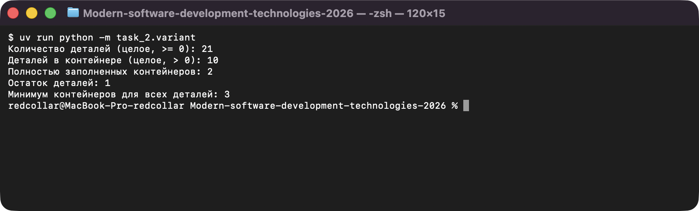
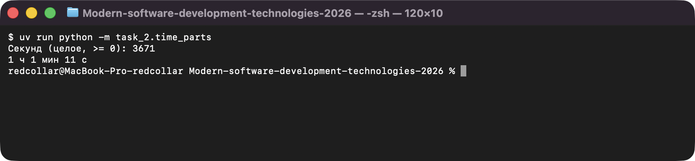
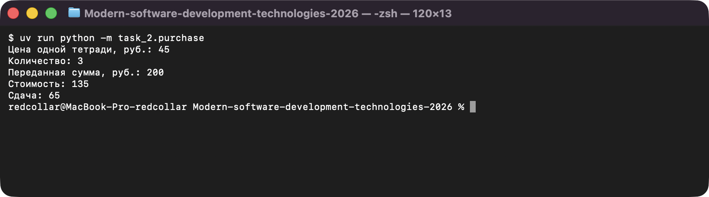

# Задание 2. Вычисления и проверка результата

Исполнитель: Извеков Евгений Александрович, группа Ум-262, **вариант 4**.
Источник условия: [02_Вычисления.md](https://github.com/vvdRTM/Python2026/blob/main/02_Вычисления.md).

## Условие

Переводить условие задачи в арифметическое выражение, выбирать тип данных, проверять ответ вручную.

| Файл | Что сделать |
|---|---|
| `time_parts.py` | Ввести целое `total_seconds >= 0`, вывести полные часы, оставшиеся минуты и секунды (`3671` → `1 ч 1 мин 11 с`). Только `//` и `%`, без библиотек времени. |
| `purchase.py` | Ввести цену тетради (целые рубли), количество и переданную сумму (`paid >= price * count`). Вывести стоимость и сдачу (`45, 3, 200` → `135` и `65`). |
| `prediction.py` | Вручную предсказать `2 + 3 * 4`, `(2 + 3) * 4`, `17 // 5`, `17 % 5`, `-7 // 2`, затем сверить с Python. |
| `variant.py` | **Вариант 4.** Ввести количество деталей (целое ≥ 0) и число деталей в контейнере (> 0). Найти число полностью заполненных контейнеров, остаток и минимальное число контейнеров (`(total + capacity - 1) // capacity`). Без циклов и условий. |
| `circle.py` | **Дополнительно.** По положительному радиусу вычислить длину окружности и площадь круга через `math.pi` (два знака после точки). |

## Запуск

Из корня репозитория:

```bash
uv run python -m task_2.time_parts
uv run python -m task_2.purchase
uv run python -m task_2.prediction
uv run python -m task_2.variant
uv run python -m task_2.circle
```

## Прогноз и результат (`prediction.py`)

| Выражение | Прогноз (вручную) | Результат Python |
|---|---|---|
| `2 + 3 * 4` | 14 (умножение раньше сложения) | 14 |
| `(2 + 3) * 4` | 20 (скобки меняют порядок) | 20 |
| `17 // 5` | 3 | 3 |
| `17 % 5` | 2 | 2 |
| `-7 // 2` | -4 (округление вниз, а не к нулю) | -4 |

Расхождений нет. Проверка: `17 == 3 * 5 + 2` и `-7 == (-4) * 2 + 1`.

## Проверки

| Программа | Вход | Ожидаемый результат | Фактический результат |
|---|---|---|---|
| `time_parts.py` | `0` | `0 ч 0 мин 0 с` | `0 ч 0 мин 0 с` — совпало |
| `time_parts.py` | `59` | `0 ч 0 мин 59 с` | `0 ч 0 мин 59 с` — совпало |
| `time_parts.py` | `60` | `0 ч 1 мин 0 с` | `0 ч 1 мин 0 с` — совпало |
| `time_parts.py` | `3600` | `1 ч 0 мин 0 с` | `1 ч 0 мин 0 с` — совпало |
| `time_parts.py` | `3671` | `1 ч 1 мин 11 с` | `1 ч 1 мин 11 с` — совпало |
| `purchase.py` | `45, 3, 135` | стоимость `135`, сдача `0` | `135`, `0` — совпало |
| `purchase.py` | `45, 3, 200` | стоимость `135`, сдача `65` | `135`, `65` — совпало |
| `purchase.py` | `45, 0, 100` | стоимость `0`, сдача `100` | `0`, `100` — совпало |
| `variant.py` | `0, 10` | полных `0`, остаток `0`, всего `0` | `0`, `0`, `0` — совпало |
| `variant.py` | `20, 10` | полных `2`, остаток `0`, всего `2` | `2`, `0`, `2` — совпало |
| `variant.py` | `21, 10` | полных `2`, остаток `1`, всего `3` | `2`, `1`, `3` — совпало |
| `variant.py` | `7, 3` (свой пример) | полных `2`, остаток `1`, всего `3` | `2`, `1`, `3` — совпало |
| `circle.py` | `1` | длина `6.28`, площадь `3.14` | `6.28`, `3.14` — совпало |

## Вопросы для защиты (кратко)

- **`/` и `//`.** `/` даёт дробное (`7 / 2 == 3.5`), `//` — целое, округлённое вниз (`7 // 2 == 3`, `-7 // 2 == -4`).
- **Остаток.** `a == (a // b) * b + a % b`: остаток — то, что не уместилось в целые группы.
- **`float` и форматирование.** `:.2f` меняет только вывод; `0.1 + 0.2` в памяти остаётся `0.30000000000000004`.
- **Потолочное деление.** `(total + capacity - 1) // capacity` округляет вверх без `math.ceil`; для `0` деталей даёт `0`.

## Скриншоты

Запуск программ (ввод подставлен автоматически, вывод — реальный):

**variant.py — контейнеры (вариант 4)**



**time_parts.py — перевод времени**



**purchase.py — стоимость покупки**


