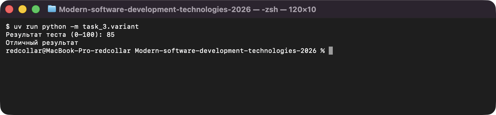
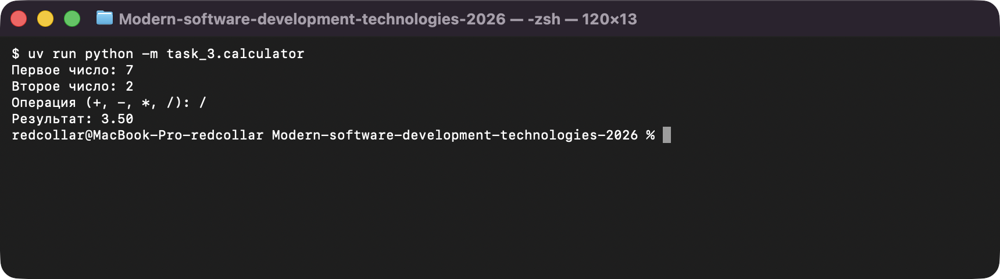

# Задание 3. Условия и логические выражения

Исполнитель: Извеков Евгений Александрович, группа Ум-262, **вариант 4**.
Источник условия: [03_Условия.md](https://github.com/vvdRTM/Python2026/blob/main/03_Условия.md).

## Условие

Строить программы с несколькими путями выполнения и проверять границы условий.

| Файл | Что сделать |
|---|---|
| `minimum.py` | Ввести три целых и найти минимальное через `if`/`elif`/`else`, без `min`, `max` и сортировки. Равные числа допускаются. |
| `calculator.py` | Ввести два вещественных числа и операцию `+`, `-`, `*`, `/`. Результат с двумя знаками. Деление на ноль → `Деление на ноль запрещено`, другая операция → `Неизвестная операция`. Без `eval()`. |
| `point.py` | Ввести `x`, `y`. Прямоугольник: `0 <= x <= 5`, `0 <= y <= 3`, границы включены. Вывести `Внутри или на границе` либо `Снаружи`. |
| `variant.py` | **Вариант 4 — результат теста.** Ввести целое 0–100; вне диапазона → `Ошибка диапазона`. 0–49: `Нужна доработка`, 50–84: `Зачёт`, 85–100: `Отличный результат`. |
| `leap_year.py` | **Дополнительно.** Определить високосность года (1–9999) по григорианскому правилу: `да` / `нет`. |

## Запуск

Из корня репозитория:

```bash
uv run python -m task_3.minimum
uv run python -m task_3.calculator
uv run python -m task_3.point
uv run python -m task_3.variant
uv run python -m task_3.leap_year
```

## Проверки

| Программа | Ввод | Ожидаемый ответ | Фактический ответ |
|---|---|---|---|
| `minimum.py` | `2, 10, 3` | `2` | `Минимум: 2` — совпало |
| `minimum.py` | `5, 5, 5` | `5` | `Минимум: 5` — совпало |
| `minimum.py` | `-4, 0, -2` | `-4` | `Минимум: -4` — совпало |
| `minimum.py` | `9, 8, 1` (минимум последний) | `1` | `Минимум: 1` — совпало |
| `calculator.py` | `7, 2, /` | `3.50` | `Результат: 3.50` — совпало |
| `calculator.py` | `5, 0, /` | `Деление на ноль запрещено` | `Деление на ноль запрещено` — совпало |
| `calculator.py` | `5, 2, ?` | `Неизвестная операция` | `Неизвестная операция` — совпало |
| `calculator.py` | `7, 2, +` / `-` / `*` | `9.00` / `5.00` / `14.00` | `9.00` / `5.00` / `14.00` — совпало |
| `point.py` | `2, 2` | внутри | `Внутри или на границе` — совпало |
| `point.py` | `5, 3` | на границе, подходит | `Внутри или на границе` — совпало |
| `point.py` | `0, 0` | угол, подходит | `Внутри или на границе` — совпало |
| `point.py` | `5.1, 3` | снаружи | `Снаружи` — совпало |
| `point.py` | `-0.1, 1` | снаружи | `Снаружи` — совпало |
| `variant.py` | `-1` | `Ошибка диапазона` | `Ошибка диапазона` — совпало |
| `variant.py` | `0` | `Нужна доработка` | `Нужна доработка` — совпало |
| `variant.py` | `49` | `Нужна доработка` | `Нужна доработка` — совпало |
| `variant.py` | `50` | `Зачёт` | `Зачёт` — совпало |
| `variant.py` | `84` | `Зачёт` | `Зачёт` — совпало |
| `variant.py` | `85` | `Отличный результат` | `Отличный результат` — совпало |
| `variant.py` | `100` | `Отличный результат` | `Отличный результат` — совпало |
| `variant.py` | `101` | `Ошибка диапазона` | `Ошибка диапазона` — совпало |
| `leap_year.py` | `1900` / `2000` / `2024` / `2023` | нет / да / да / нет | нет / да / да / нет — совпало |

## Вопросы для защиты (кратко)

- **`and` / `or`.** Принадлежность прямоугольнику требует выполнения обоих условий (`and`), выход за диапазон — любого из двух (`or`).
- **Порядок ветвей.** В цепочке `if`/`elif` выполняется первая подходящая ветвь, поэтому проверка диапазона идёт первой, а категории — от низкой к высокой.
- **Равенство значений.** В `minimum.py` сравнения нестрогие (`<=`), поэтому при равных числах результат корректен.

## Скриншоты

Запуск программ (ввод подставлен автоматически, вывод — реальный):

**variant.py — результат теста (вариант 4)**



**calculator.py — калькулятор**


