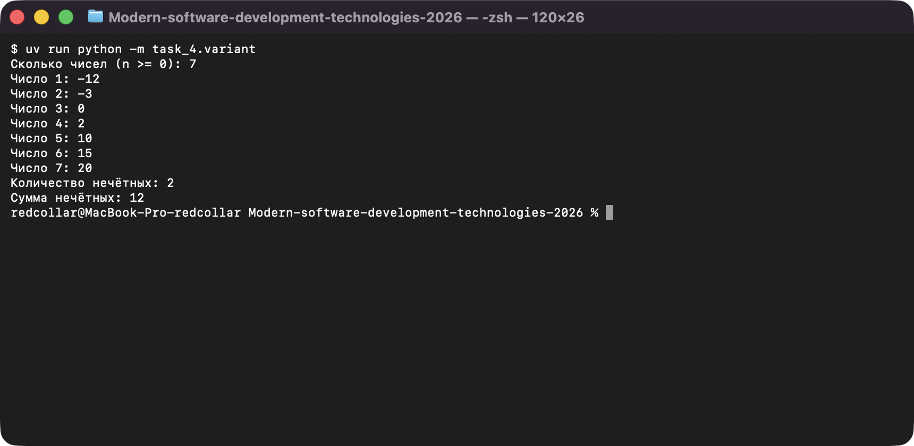
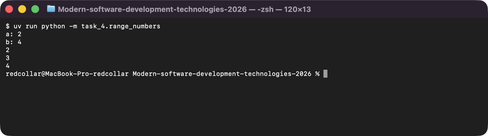

# Задание 4. Циклы, счётчики и накопители

Исполнитель: Извеков Евгений Александрович, группа Ум-262, **вариант 4**.
Источник условия: [04_Циклы.md](https://github.com/vvdRTM/Python2026/blob/main/04_Циклы.md).

## Условие

Выбирать между `for` и `while`, накапливать результат и объяснять завершение цикла.

| Файл | Что сделать |
|---|---|
| `range_numbers.py` | Ввести целые `a`, `b`, вывести числа от `a` до `b` включительно: по возрастанию при `a < b`, по убыванию при `a > b`, одно число при равенстве. По числу на строке. |
| `statistics.py` | Ввести `n >= 1` и ровно `n` целых. Найти сумму, число положительных и максимум (без списка; максимум инициализируется первым числом). |
| `positive_input.py` | Запрашивать целое, пока не будет введено положительное. Вывести квадрат и число отклонённых попыток. |
| `variant.py` | **Вариант 4 — нечётные числа.** Ввести `n >= 0` и `n` целых. Одним циклом найти количество и сумму нечётных, без списка. Нет подходящих — оба результата `0`. |
| `prime.py` | **Дополнительно.** Проверить простоту `n >= 2`, перебирая делители, пока `divisor * divisor <= n`. |
| `trace_sum.py` | Трассировка цикла суммирования 1–4 (значения до и после каждой итерации). |

## Запуск

Из корня репозитория:

```bash
uv run python -m task_4.range_numbers
uv run python -m task_4.statistics
uv run python -m task_4.positive_input
uv run python -m task_4.variant
uv run python -m task_4.prime
uv run python -m task_4.trace_sum
```

## Таблица значений цикла суммирования 1–4

Вывод `trace_sum.py`:

| Итерация | `number` | `total` до | `total` после |
|---|---|---|---|
| 1 | 1 | 0 | 1 |
| 2 | 2 | 1 | 3 |
| 3 | 3 | 3 | 6 |
| 4 | 4 | 6 | 10 |

## Проверки

| Программа | Ввод | Ожидаемый результат | Фактический результат |
|---|---|---|---|
| `range_numbers.py` | `2, 4` | `2`, `3`, `4` | `2`, `3`, `4` — совпало |
| `range_numbers.py` | `4, 2` | `4`, `3`, `2` | `4`, `3`, `2` — совпало |
| `range_numbers.py` | `3, 3` | `3` | `3` — совпало |
| `statistics.py` | `n=3`: `-5, -2, -8` | сумма `-15`, положительных `0`, максимум `-2` | `-15`, `0`, `-2` — совпало |
| `statistics.py` | `n=1`: `0` | `0`, `0`, `0` | `0`, `0`, `0` — совпало |
| `positive_input.py` | `0, -2, 3` | квадрат `9`, отклонено `2` | `9`, `2` — совпало |
| `variant.py` | `n=7`: `-12 -3 0 2 10 15 20` (контрольный набор) | количество `2`, сумма `12` | `2`, `12` — совпало |
| `variant.py` | `n=5`: `-2 0 3 10 20` | количество `1`, сумма `3` | `1`, `3` — совпало |
| `variant.py` | `n=4`: `1 -1 3 5` (все нечётные, с отрицательным) | количество `4`, сумма `8` | `4`, `8` — совпало |
| `variant.py` | `n=0` | `0`, `0` | `0`, `0` — совпало |
| `variant.py` | `n=3`: `2 4 6` (нет подходящих) | `0`, `0` | `0`, `0` — совпало |
| `prime.py` | `2` / `9` / `17` / `49` | простое / составное / простое / составное | простое / составное / простое / составное — совпало |

## Вопросы для защиты (кратко)

- **Почему циклы завершаются.** `for` перебирает конечный `range`; в `positive_input.py` цикл `while` завершится, как только введено положительное число; в `prime.py` `divisor` растёт на 1, и условие `divisor * divisor <= n` рано или поздно нарушится.
- **Почему не просто `range(a, b)`.** `stop` не входит в диапазон, и при `a > b` пустой диапазон: нужны `b + 1` при возрастании и `b - 1` с шагом `-1` при убывании.
- **Нечётность отрицательных.** В Python `-3 % 2 == 1`, поэтому проверка `number % 2 != 0` верна и для отрицательных (в отличие от `== 1`).
- **Сложность `prime.py`.** В худшем случае порядка `sqrt(n)` проверок делимости.

## Скриншоты

Запуск программ (ввод подставлен автоматически, вывод — реальный):

**variant.py — нечётные числа (вариант 4)**



**range_numbers.py — диапазон в обе стороны**


