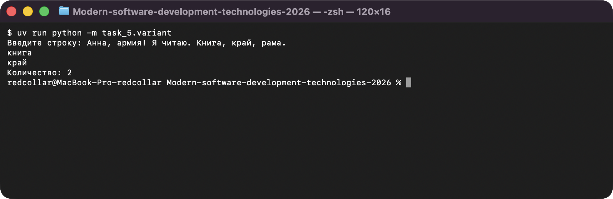
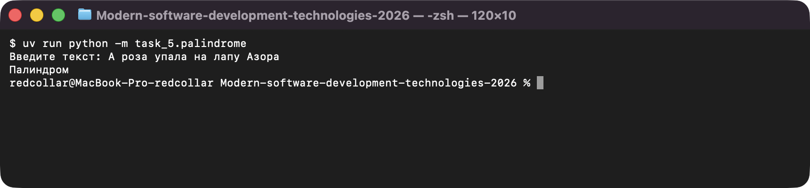

# Задание 5. Обработка строк

Исполнитель: Извеков Евгений Александрович, группа Ум-262, **вариант 4**.
Источник условия: [05_Строки.md](https://github.com/vvdRTM/Python2026/blob/main/05_Строки.md).

## Условие

Обрабатывать текст с помощью индексов, срезов, методов и циклов; заранее определять правила сравнения текста.

| Файл | Что сделать |
|---|---|
| `normalize.py` | Убрать пробельные символы по краям, схлопнуть внутренние в один пробел, сохранить регистр. Вывести исходную и новую длину, текст и число слов (слово — непустая часть `split()`). |
| `palindrome.py` | Проверить палиндром: игнорировать регистр и обычные пробелы `" "`, прочие символы сравнивать как есть. Пусто после очистки → `Нет текста`, иначе `Палиндром` / `Не палиндром`. Использовать `[::-1]`. |
| `replace.py` | Заменить двоеточия на дефисы; сначала подсчитать вхождения, затем заменить. Вывести число замен и новую строку. |
| `variant.py` | **Вариант 4 — слова, начинающиеся с `к`.** Разбить строку по пробельным символам, у каждого слова обрезать `.,!?;:` по краям (`strip`), перевести в нижний регистр, пустые пропустить. Вывести подходящие слова по одному на строке и их количество (повторы сохраняются). Нет совпадений → `Нет совпадений` и количество `0`. |
| `palindrome_loop.py` | **Дополнительно.** Палиндром без обратного среза (обход половины очищенной строки), сравнение с решением через срез на одинаковых входах. |

## Запуск

Из корня репозитория:

```bash
uv run python -m task_5.normalize
uv run python -m task_5.palindrome
uv run python -m task_5.replace
uv run python -m task_5.variant
uv run python -m task_5.palindrome_loop
```

## Проверки

| Программа | Ввод | Ожидаемый результат | Фактический результат |
|---|---|---|---|
| `normalize.py` | `  Один   два  ` | `Один два`, слов `2`, новая длина `8` | `Один два`, `2`, `8` (исходная длина `14`) — совпало |
| `normalize.py` | пустая строка | длина `0`, слов `0` | `0`, `0` — совпало |
| `normalize.py` | `  Python   И  ДАННЫЕ  ` | `Python И ДАННЫЕ`, слов `3` | `Python И ДАННЫЕ`, `3` — совпало |
| `palindrome.py` | `А роза упала на лапу Азора` | `Палиндром` | `Палиндром` — совпало |
| `palindrome.py` | `а` и четыре пробела | `Палиндром` | `Палиндром` — совпало |
| `palindrome.py` | только пробелы | `Нет текста` | `Нет текста` — совпало |
| `palindrome.py` | `Python` | `Не палиндром` | `Не палиндром` — совпало |
| `palindrome.py` | `А!` | `Не палиндром` (пунктуация сравнивается) | `Не палиндром` — совпало |
| `replace.py` | `a::b:` | `a--b-`, замен `3` | `a--b-`, `3` — совпало |
| `replace.py` | `abc` | `abc`, замен `0` | `abc`, `0` — совпало |
| `variant.py` | `Анна, армия! Я читаю. Книга, край, рама.` (контрольный текст) | `книга`, `край`, количество `2` | `книга`, `край`, `2` — совпало |
| `variant.py` | `Анна, армия! Я читаю.` | совпадений нет, количество `0` | `Нет совпадений`, `0` — совпало |
| `variant.py` | `Кот, КНИГА... ,` (регистр, пунктуация, одинокая запятая) | `кот`, `книга`, `2` | `кот`, `книга`, `2` — совпало |
| `variant.py` | пустая строка | `Нет совпадений`, `0` | `Нет совпадений`, `0` — совпало |
| `variant.py` | `!!!` | `Нет совпадений`, `0` | `Нет совпадений`, `0` — совпало |
| `palindrome_loop.py` | 8 образцов (`abba`, `abc`, `""`, `А!` и др.) | оба решения дают одинаковый ответ | во всех строках `совпали` — совпало |

## Вопросы для защиты (кратко)

- **Неизменяемость строк.** `text.lower()` возвращает новую строку и не меняет `text`, результат надо присваивать или использовать.
- **Слово и подстрока.** Слово — часть, выделенная `split()`; подстрока может быть частью слова (`ра` в `рама`).
- **Правила пунктуации заранее.** В палиндроме `А!` либо палиндром (если знаки игнорировать), либо нет (если сравнивать как есть); от решения зависит программа, поэтому правило фиксируется до кода.
- **Пустые слова.** Слово из одних знаков (`,`) после `strip` становится пустым, и обращение к `[0]` дало бы ошибку: такие слова пропускаются, а для проверки начала используется `startswith()`.

## Скриншоты

Запуск программ (ввод подставлен автоматически, вывод — реальный):

**variant.py — слова на «к» (вариант 4)**



**palindrome.py — палиндром**


