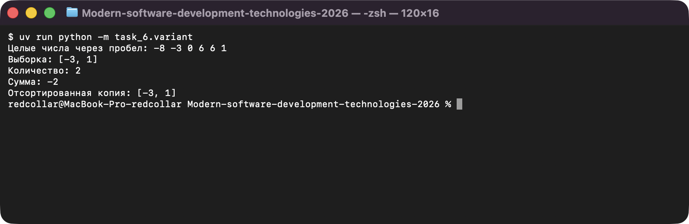
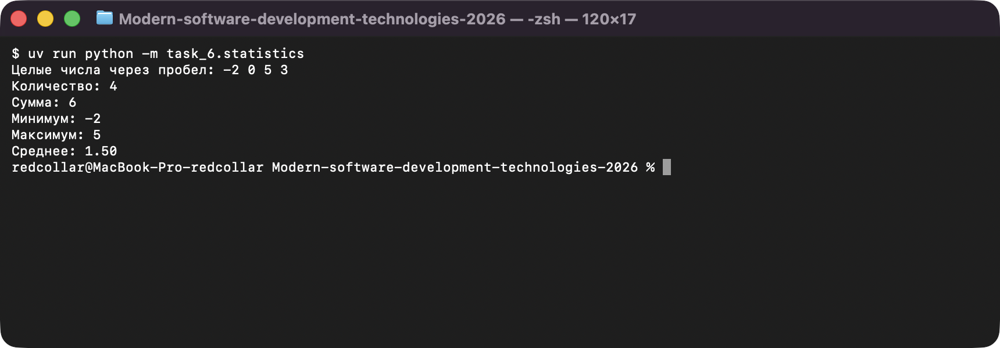

# Задание 6. Списки

Исполнитель: Извеков Евгений Александрович, группа Ум-262, **вариант 4**.
Источник условия: [06_Списки.md](https://github.com/vvdRTM/Python2026/blob/main/06_Списки.md).

## Условие

Создавать списки, обходить и изменять их, фильтровать значения и сохранять исходные данные. Числа вводятся одной строкой через пробел.

| Файл | Что сделать |
|---|---|
| `statistics.py` | Вывести количество, сумму, минимум, максимум и среднее (два знака). Пустой ввод → только `Нет данных`. |
| `transform.py` | Построить новый список, заменив отрицательные числа модулями; вывести исходный и новый. Исходный сохраняется, пустой ввод допустим. |
| `positions.py` | Найти все индексы максимального элемента по возрастанию (`3 7 2 7` → `[1, 3]`), обход через `enumerate()`. Пустой список → `Нет данных`. |
| `variant.py` | **Вариант 4 — нечётные числа.** Создать список нечётных в исходном порядке; вывести его, количество, сумму и отсортированную копию. Нет подходящих → `[]`, `0`, `0`, `[]`. |
| `unique.py` | **Дополнительно.** Удалить повторы с сохранением порядка первого появления без `set` (`[3, 1, 3, 2, 1]` → `[3, 1, 2]`). |

## Запуск

Из корня репозитория:

```bash
uv run python -m task_6.statistics
uv run python -m task_6.transform
uv run python -m task_6.positions
uv run python -m task_6.variant
uv run python -m task_6.unique
```

## Проверки

| Программа | Ввод | Ожидаемый результат | Фактический результат |
|---|---|---|---|
| `statistics.py` | `-2 0 5 3` | кол-во `4`, сумма `6`, мин `-2`, макс `5`, среднее `1.50` | `4`, `6`, `-2`, `5`, `1.50` — совпало |
| `statistics.py` | `8` | всё `8` / `8.00`, кол-во `1` | `1`, `8`, `8`, `8`, `8.00` — совпало |
| `statistics.py` | пустая строка | `Нет данных` | `Нет данных` — совпало |
| `transform.py` | `-2 0 5 -2` | новый `[2, 0, 5, 2]`, исходный `[-2, 0, 5, -2]` | то же — совпало (исходный сохранён) |
| `transform.py` | пустая строка | оба списка пусты | `[]` и `[]` — совпало |
| `positions.py` | `3 7 2 7` | `[1, 3]` | `[1, 3]` — совпало |
| `positions.py` | `7 7` | `[0, 1]` | `[0, 1]` — совпало |
| `positions.py` | `-3 -1 -2` | `[1]` | `[1]` — совпало |
| `positions.py` | пустая строка | `Нет данных` | `Нет данных` — совпало |
| `variant.py` | `-8 -3 0 6 6 1` (контрольный) | `[-3, 1]`, количество `2`, сумма `-2` | `[-3, 1]`, `2`, `-2`, сортировка `[-3, 1]` — совпало |
| `variant.py` | `5 -3 4 5 1 2` (непустая выборка с повтором) | `[5, -3, 5, 1]`, `4`, `8`, сорт. `[-3, 1, 5, 5]` | то же — совпало |
| `variant.py` | пустая строка | `[]`, `0`, `0`, `[]` | то же — совпало |
| `variant.py` | `2 4 0` (нет совпадений) | `[]`, `0`, `0`, `[]` | то же — совпало |
| `unique.py` | `3 1 3 2 1` | `[3, 1, 2]` | `[3, 1, 2]` — совпало |

## Вопросы для защиты (кратко)

- **Сохранность исходного списка.** В `transform.py` результат строится в отдельном списке `result` через `append`, поэтому `numbers` не меняется (это видно по выводу обоих списков).
- **`append()` и присваивание по индексу.** `append` добавляет элемент в конец; `items[i] = value` заменяет уже существующий.
- **`sorted()` и `sort()`.** `sorted` возвращает новый список и не меняет исходный; `sort()` сортирует на месте и возвращает `None`.
- **Нечётность отрицательных.** `-3 % 2 == 1` в Python, поэтому `number % 2 != 0` верно и для них.

## Скриншоты

Запуск программ (ввод подставлен автоматически, вывод — реальный):

**variant.py — нечётные числа (вариант 4)**



**statistics.py — статистика списка**


