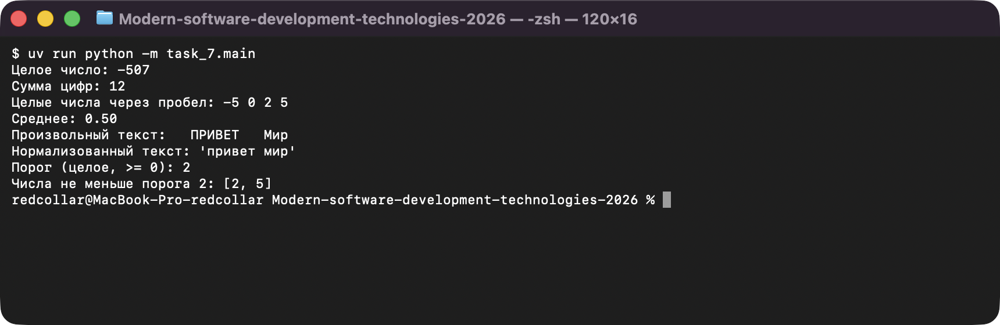
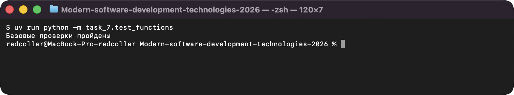

# Задание 7. Функции и проверки

Исполнитель: Извеков Евгений Александрович, группа Ум-262, **вариант 4**.
Источник условия: [07_Функции.md](https://github.com/vvdRTM/Python2026/blob/main/07_Функции.md).

## Условие

Разделять вычисления и взаимодействие с пользователем, передавать параметры, возвращать результат и проверять поведение функций.

| Файл | Что сделать |
|---|---|
| `functions.py` | Функции без `input()`/`print()`: `sum_digits(number)` — сумма цифр модуля (для 0 — 0), `average(numbers)` — среднее или `None` для пустого списка, `normalize_text(text)` — нижний регистр, без краевых пробелов, один пробел между словами. |
| `functions.py` (вариант) | **Вариант 4:** `select_numbers(numbers, threshold)` — новый список чисел, **не меньших порога**, порядок и повторы сохраняются. Пример: `[-5, 0, 2, 5]`, порог `2` → `[2, 5]`. |
| `functions.py` (доп.) | **Дополнительно:** `is_palindrome(text)` по правилам работы №5; для пустого нормализованного текста — `False`. Проверки написаны до реализации. |
| `main.py` | Запросить целое, строку чисел и текст; продемонстрировать три функции (пустой список → `Нет данных`); запросить порог и применить `select_numbers` к введённому списку. |
| `test_functions.py` | Проверки на `assert`: базовый набор, вариант, `is_palindrome`. |

## Запуск

Из корня репозитория — две команды:

```bash
uv run python -m task_7.main
uv run python -m task_7.test_functions
```

## Проверки

Автоматические (`test_functions.py`, выводит `Базовые проверки пройдены`):

| Что проверяется | Ожидаемое | Фактическое |
|---|---|---|
| `sum_digits(0)`, `sum_digits(507)`, `sum_digits(-507)` | `0`, `12`, `12` | совпало |
| `average([])`, `average([2, 4, 6])`, `average([1, 2])` | `None`, `4`, `1.5` (сравнение с допуском `1e-9`) | совпало |
| `normalize_text("  ПРИВЕТ   Мир  ")`, `normalize_text("   ")` | `"привет мир"`, `""` | совпало |
| `select_numbers([-5, 0, 2, 5], 2)` | `[2, 5]` | совпало |
| пустой список; нет совпадений (`[-5, 0, 1]`, порог 2) | `[]` | совпало |
| граница включена: `[1, 2, 3]`, порог `2` и `3` | `[2, 3]` и `[3]` | совпало |
| повторы сохраняются: `[3, 1, 3, 2, 3]`, порог `3` | `[3, 3, 3]` | совпало |
| порог `0` для `[-5, 0, 2, 5]` | `[0, 2, 5]` | совпало |
| исходный список после вызова равен сохранённой копии | равен | совпало |
| `is_palindrome` для «А роза упала на лапу Азора», `Python`, `""`, пробелов, `а`, `А!` | `True`, `False`, `False`, `False`, `True`, `False` | совпало |

Ручные запуски `main.py` (ввод по порядку: целое, числа, текст, порог):

| Ввод | Ожидаемый результат | Фактический результат |
|---|---|---|
| `-507`, `-5 0 2 5`, `  ПРИВЕТ   Мир  `, `2` | сумма цифр `12`, среднее `0.50`, `привет мир`, `[2, 5]` | `12`, `0.50`, `'привет мир'`, `[2, 5]` — совпало |
| `0`, пустая строка, пробелы, `2` | `0`, `Нет данных`, `''`, `[]` | `0`, `Нет данных`, `''`, `[]` — совпало |
| `12345`, `1 2`, `Hello`, `5` | `15`, `1.50`, `hello`, `[]` | `15`, `1.50`, `'hello'`, `[]` — совпало |

### Тест обнаруживает неправильное решение

В копии `functions.py` намеренно удалена строка `number = abs(number)` (в проект изменение не попало). Запуск тестов:

```text
  File ".../task_7/test_functions.py", line 6, in <module>
    assert sum_digits(-507) == 12
AssertionError
```

Тест на отрицательное число обнаружил ошибку: без `abs` цикл `while number > 0` не выполняется, и результат равен `0`. В проекте исправная версия.

## Вопросы для защиты (кратко)

- **Возврат и вывод.** `return` отдаёт значение вызывающему коду и его можно тестировать; `print` только показывает его человеку, вернув `None`.
- **Параметр и локальная переменная.** Параметр — имя в определении, получает значение при вызове; локальная переменная создаётся внутри функции и снаружи недоступна.
- **`if __name__ == "__main__"`.** `main()` вызывается при запуске файла и не вызывается при импорте, поэтому тесты импортируют функции без побочных эффектов.
- **`assert` и ввод пользователя.** `assert` используется для учебных проверок функций; ввод проверяют условиями и исключениями, так как `assert` отключается при оптимизации.

## Скриншоты

Запуск программ (ввод подставлен автоматически, вывод — реальный):

**main.py — демонстрация функций, включая select_numbers (вариант 4)**



**test_functions.py — проверки**


