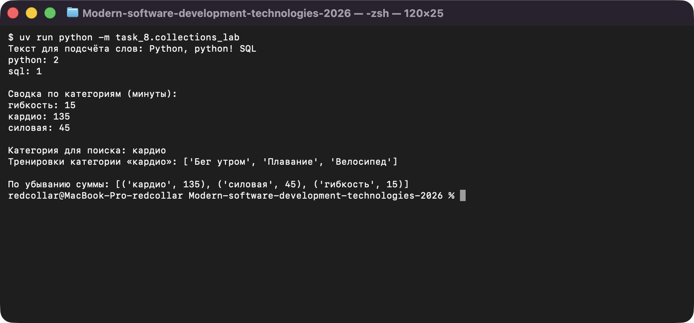
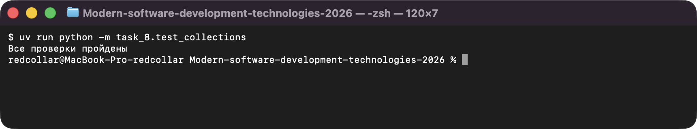

# Задание 8. Словари, множества, кортежи

Исполнитель: Извеков Евгений Александрович, группа Ум-262, **вариант 4**.
Источник условия: [08_Коллекции.md](https://github.com/vvdRTM/Python2026/blob/main/08_Коллекции.md).

## Условие

Выбирать структуру данных для записи, уникальных значений и пар; обрабатывать список словарей.

| Файл | Что сделать |
|---|---|
| `collections_lab.py` | `word_counts(text)` — словарь «слово → количество» (нижний регистр, обрезка `.,!?;:` по краям, пустые пропускаются) и функция вывода пар по алфавиту. `common_topics(first, second)` и `all_topics(first, second)` — отсортированные общие / все уникальные темы через множества. |
| `collections_lab.py` (вариант) | **Вариант 4 — спортивные тренировки, `amount` = минуты.** Не менее пяти записей, три категории (одна повторяется). `totals_by_category(records)` — суммы `amount` по категориям; `titles_in_category(records, category)` — названия в исходном порядке (неизвестная категория → `[]`). Вывод сводки по алфавиту и поиск по категории, введённой пользователем. Записи не изменяются. |
| `collections_lab.py` (доп.) | **Дополнительно:** `sorted_totals(records)` — пары `(категория, сумма)` по убыванию суммы, затем по названию категории (аргумент `key` у `sorted`). |
| `record_demo.py` | Задание 3: словарь с `title` и `hours`, изменить `hours`, добавить `completed=False`, создать кортеж `(title, hours)` и распаковать. |
| `test_collections.py` | Проверки на `assert`. |

Собственный набор тренировок (вымышленные данные):

| title | category | amount (мин) |
|---|---|---|
| Бег утром | кардио | 30 |
| Плавание | кардио | 45 |
| Приседания | силовая | 20 |
| Жим лёжа | силовая | 25 |
| Растяжка | гибкость | 15 |
| Велосипед | кардио | 60 |

Ожидаемая сводка (посчитана вручную): кардио `30 + 45 + 60 = 135`, силовая `20 + 25 = 45`, гибкость `15`.

## Запуск

Из корня репозитория:

```bash
uv run python -m task_8.collections_lab
uv run python -m task_8.record_demo
uv run python -m task_8.test_collections
```

## Проверки

Автоматические (`test_collections.py`, выводит `Все проверки пройдены`):

| Что проверяется | Ожидаемое | Фактическое |
|---|---|---|
| `word_counts("Python, python! SQL")` | `{"python": 2, "sql": 1}` | совпало |
| `word_counts("!!!")`, `word_counts("")` | `{}` | совпало |
| темы `["python", "sql", "python"]` и `["sql", "git"]` | общие `["sql"]`, все `["git", "python", "sql"]` | совпало |
| один список тем пуст | пересечение `[]`, объединение — уникальные другого | совпало |
| общий набор из условия: сводка | `{"основное": 7, "дополнительное": 2}` | совпало |
| поиск `основное` / `нет` | `["A", "C"]` / `[]` | совпало |
| сводка пустого списка | `{}` | совпало |
| исходные записи после вызовов равны копии `[record.copy() for ...]` | равны | совпало |
| тренировки: сводка | `{"кардио": 135, "силовая": 45, "гибкость": 15}` | совпало |
| тренировки: `кардио` / `гибкость` / `йога` | `["Бег утром", "Плавание", "Велосипед"]` / `["Растяжка"]` / `[]` | совпало |
| `sorted_totals(тренировки)`; при равных суммах (`б`, `а` по 5); пустой список | `[("кардио",135),("силовая",45),("гибкость",15)]`; `[("а",5),("б",5)]`; `[]` | совпало |

Ручные запуски:

| Программа | Ввод | Ожидаемый результат | Фактический результат |
|---|---|---|---|
| `collections_lab.py` | текст `Python, python! SQL`, категория `кардио` | `python: 2`, `sql: 1`; сводка: гибкость 15, кардио 135, силовая 45; поиск `['Бег утром', 'Плавание', 'Велосипед']` | то же — совпало |
| `collections_lab.py` | текст `!!!`, категория `йога` | слов нет; сводка та же; поиск `[]` | то же — совпало |
| `record_demo.py` | — | запись `{'title': 'Python', 'hours': 6, 'completed': False}`, пара `Python, 6` | то же — совпало |

## Вопросы для защиты (кратко)

- **Выбор структур.** Частоты слов — `dict` (ключ → счётчик); темы — `set` (уникальность, `&` и `|`); запись и пара — `dict` и `tuple`.
- **Почему запись — словарь.** Поля доступны по имени (`record["hours"]`), а не по номеру позиции, их можно добавлять; код читается лучше, чем с кортежем или списком.
- **`.get()`.** `counts.get(word, 0)` возвращает `0`, если ключа нет, вместо `KeyError`, что удобно для счётчиков.
- **Сортировка множества.** У множества нет гарантированного порядка, поэтому перед выводом применяется `sorted(...)` — результат воспроизводим.

## Скриншоты

Запуск программ (ввод подставлен автоматически, вывод — реальный):

**collections_lab.py — частоты слов и сводка тренировок (вариант 4)**



**test_collections.py — проверки**


