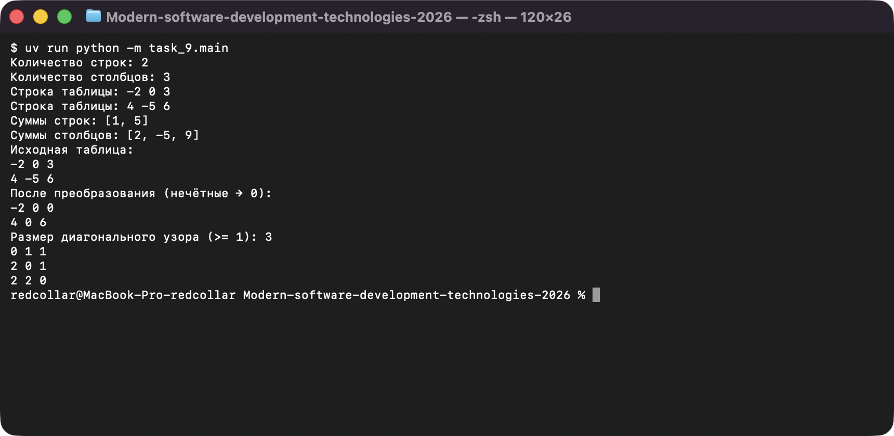
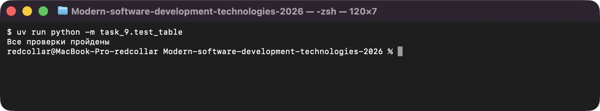

# Задание 9. Вложенные списки и таблицы

Исполнитель: Извеков Евгений Александрович, группа Ум-262, **вариант 4**.
Источник условия: [09_Таблицы.md](https://github.com/vvdRTM/Python2026/blob/main/09_Таблицы.md).

## Условие

Обрабатывать прямоугольную таблицу вложенными циклами, различать строки и столбцы, не создавать общие изменяемые строки случайно.

| Файл | Что сделать |
|---|---|
| `table.py` | Функции без ввода/вывода: `row_sums(matrix)`, `column_sums(matrix)` (для `[]` — `[]`) и `diagonal_pattern(size)` (на главной диагонали `0`, выше `1`, ниже `2`). Матрицу не менять. |
| `table.py` (вариант) | **Вариант 4:** `transform(matrix)` — новая матрица той же формы, **нечётные элементы заменены нулями**. Для `[[-2, 0, 3], [4, -5, 6]]` → `[[-2, 0, 0], [4, 0, 6]]`. Для `[]` — `[]`. |
| `main.py` | Ввод прямоугольной матрицы с проверкой длины строк; суммы строк и столбцов; исходная и преобразованная таблицы; ввод размера и вывод диагонального узора. |
| `test_table.py` | Проверки на `assert`. |
| `recursion.py` | **Дополнительно (рекурсия):** факториал рекурсивно и итеративно, трассировка `factorial(3)`, сравнение для чисел 0–20. |

> Проверка нечётности (`is_odd`) вынесена в общий пакет [`common`](../README.md#общий-код), потому что та же проверка нужна в задании 10. Модуль `table.py` из этого задания используется в задании 10.

## Запуск

Из корня репозитория:

```bash
uv run python -m task_9.main
uv run python -m task_9.test_table
uv run python -m task_9.recursion
```

## Проверки

Автоматические (`test_table.py`, выводит `Все проверки пройдены`):

| Что проверяется | Ожидаемое | Фактическое |
|---|---|---|
| `[[1, 2, 3], [4, 5, 6]]` | суммы строк `[6, 15]`, столбцов `[5, 7, 9]` | совпало |
| `[[7]]`; узор размера `1` | суммы `[7]` и `[7]`; `[[0]]` | совпало |
| `[[1], [-1], [0]]` | строки `[1, -1, 0]`, столбцы `[0]` | совпало |
| пустая матрица | суммы и `transform` → `[]` | совпало |
| узор размера `3` | `[[0,1,1],[2,0,1],[2,2,0]]` | совпало |
| вариант 4: `[[-2, 0, 3], [4, -5, 6]]` | `[[-2, 0, 0], [4, 0, 6]]` | совпало |
| исходная матрица после `transform`; изменение `result[0][0]` | исходная не изменилась | совпало |
| все нечётные / нет нечётных / `[[-1]]` | `[[0,0],[0,0]]` / без изменений / `[[0]]` | совпало |

Ручные запуски `main.py`:

| Ввод | Ожидаемый результат | Фактический результат |
|---|---|---|
| `2`, `3`, строки `-2 0 3` и `4 -5 6`, размер `3` | суммы строк `[1, 5]`, столбцов `[2, -5, 9]`; после преобразования `-2 0 0` / `4 0 6`; узор 3×3 | то же — совпало |
| строки неверной длины (`1 2`, `1 2 3 4`), затем верные | два раза «Нужно ровно 3 чисел», затем ввод принят | то же — совпало |
| таблица 3×1: `1`, `-1`, `0`; размер `2` | строки `[1, -1, 0]`, столбцы `[0]`; преобразованный столбец `0 0 0`; узор `0 1` / `2 0` | то же — совпало |
| `recursion.py` | трассировка вызовов `3, 2, 1, 0` и возвратов `1, 1, 2, 6`; версии совпали для 0–20 | то же — совпало |

## Вопросы для защиты (кратко)

- **Таблица 2×3.** Она выявляет путаницу строк и столбцов: если перепутать индексы, получится `IndexError` или суммы неверной длины (строк 2, столбцов 3).
- **Почему нельзя `[[0] * columns] * rows`.** Все строки были бы ссылками на один внутренний список, и изменение одной ячейки затронуло бы несколько строк.
- **Копия внешнего списка и строк.** `matrix.copy()` копирует только внешний список, строки остаются общими; независимая копия — `[row.copy() for row in matrix]`. В `transform` строки результата создаются заново.
- **Рекурсия.** Нужны базовый случай (`factorial(0) == 1`) и шаг к нему; слишком глубокая цепочка даёт `RecursionError`.

## Скриншоты

Запуск программ (ввод подставлен автоматически, вывод — реальный):

**main.py — суммы, преобразование (вариант 4) и узор**



**test_table.py — проверки**


